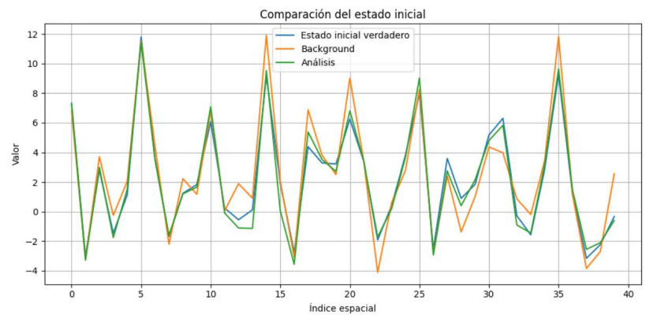
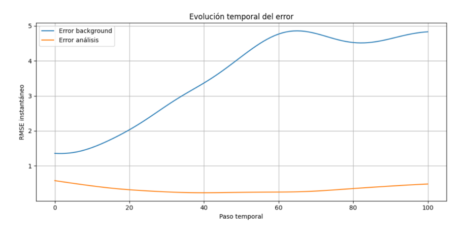
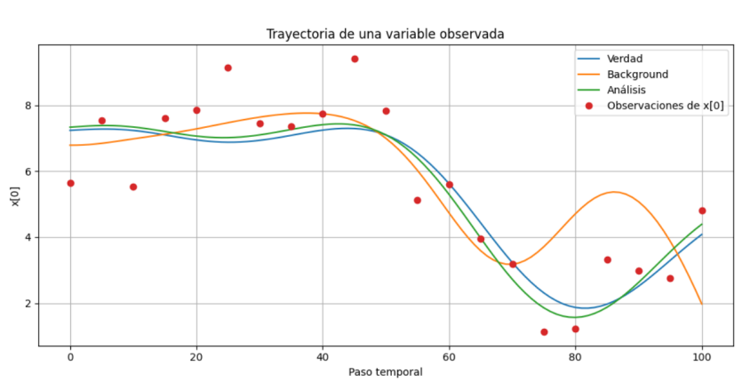

# 4D-Var Data Assimilation on the Lorenz-96 Model

Implementation of the four-dimensional variational (4D-Var) data assimilation
algorithm, applied to the chaotic Lorenz-96 system as a testbed for
state reconstruction from partial, noisy observations.

This is the numerical core of my Physics BSc thesis (Universidad Complutense
de Madrid, 2026), *"Study on Techniques for Assimilation of Observations
into Meteorological Model Outputs"* — a review of sequential (Kalman filter)
and variational (3D-Var/4D-Var) data assimilation methods, with a
from-scratch numerical implementation of 4D-Var on Lorenz-96.

## Why this problem

Numerical weather prediction requires estimating the true atmospheric state
from a combination of an imperfect model and sparse, noisy observations —
the data assimilation problem. Operational systems (e.g. ECMWF's 4D-Var
within the ERA5 reanalysis) do this on state vectors of 10⁷–10⁹ dimensions.
Lorenz-96 is the standard low-dimensional testbed for prototyping and
validating these techniques: at forcing F = 8 it is chaotic, so small
errors in the initial state grow exponentially — the same sensitivity that
makes atmospheric state estimation hard, at a computational cost that fits
on a laptop.

## Method

4D-Var finds the initial state x₀ that minimizes the cost function

  J(x₀) = ½(x₀ − x_b)ᵀB⁻¹(x₀ − x_b) + ½ Σₖ (yₖ − Hₖ(xₖ))ᵀR⁻¹(yₖ − Hₖ(xₖ))

over an assimilation window, balancing fit to a prior background state x_b
against fit to the observations yₖ. The gradient ∇J requires propagating
information backward through the model's adjoint. The adjoint here is
obtained via **automatic differentiation (JAX)** rather than hand-derived;
minimization is gradient descent with a line search for the step length.

**Twin experiment setup:**
- Model: Lorenz-96, dimension d = 40, forcing F = 8 (chaotic regime),
  cyclic boundary conditions, RK4 integration with Δt = 0.01
- A synthetic "true" trajectory is generated; observations are a noisy,
  partial projection of it (Gaussian noise, σ_obs = 1), sampled every 5
  steps over a 100-step assimilation window
- The background x_b is the true initial state perturbed with Gaussian
  noise (σ_b = 1) — standing in for the prior estimate a real system would
  take from a previous reanalysis cycle
- Skill is measured via RMSE of the reconstructed initial state and of the
  full trajectory against the known truth

## Results

**State reconstruction.** The analysis (post-assimilation estimate) tracks
the true initial state far more closely than the background prior:



**Error reduction.** RMSE of the analysis stays well below the background
error throughout the window — the algorithm is correctly exploiting the
observations rather than drifting with the free model run:



**Trajectory tracking.** The corrected (analysis) trajectory follows the
truth more closely than the uncorrected background, particularly where
observations are dense:



## Relation to operational reanalysis

The same 4D-Var structure — background + observations, minimized over an
assimilation window — underlies real reanalysis products like ECMWF's ERA5,
just at a vastly larger scale (10⁷–10⁹-dimensional state, 12h windows,
real observations rather than synthetic ones). This repo reproduces the
method's essential mechanics at a scale where every step can be inspected
and validated by hand.

## Repository contents

- `Lorentz96.ipynb` — full pipeline: nonlinear model integration, JAX-based
  adjoint, 4D-Var minimization loop, and the experiments above
- `figures/` — result plots referenced in this README
- `thesis/FTA36_Avellaneda_Calderon_Alejandro.pdf` — full thesis (theory and
  literature review of sequential and variational data assimilation
  methods, plus this numerical implementation)

## Requirements

```
numpy
scipy
jax
matplotlib
```

## Reference

Avellaneda Calderón, A. (2026). *Estudio sobre técnicas de asimilación de
observaciones en resultados de modelos meteorológicos.* BSc Thesis,
Universidad Complutense de Madrid. [Full PDF](thesis/FTA36_Avellaneda_Calderon_Alejandro.pdf)
